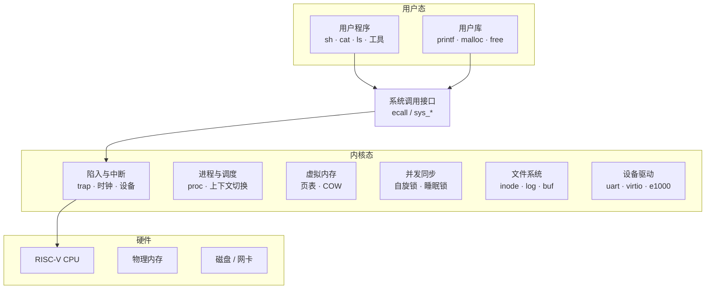

# xv6-riscv-labs

**MIT 6.S081 / 6.1810 *Operating System Engineering***

内核实现 · 原理分析 · 自主扩展

---

## 项目简介

这是一个在 RISC-V 平台上实现的类 Unix 操作系统内核项目。内核基于 MIT 的 xv6-riscv 教学内核，我在它之上逐层实现并扩展了系统调用、虚拟内存、中断与异常、并发同步、文件系统，以及设备驱动和网络等子系统。

选 xv6 是因为它足够小，整个内核能完整读懂；但每个子系统背后都牵扯到真实的底层机制，从页表映射、陷入处理到锁的粒度设计，都要先把原理想清楚再落到代码。项目想回答的也正是这个问题：操作系统的原理到底是怎么变成能跑的代码的。

每个实验都通过了课程提供的测试，其中多数在课程要求之外做了扩展，代码全部独立完成。

## 实验内容与扩展

| # | 实验 | 课程要求 | 扩展方向 |
| --- | --- | --- | --- |
| 1 | util | sleep、pingpong、primes、find、xargs | 用系统调用自行实现同类工具，补充 trace 等调试手段 |
| 2 | syscall | trace、sysinfo | 增加进程与内存统计类系统调用，完善参数校验 |
| 3 | pgtbl | 加速系统调用（USYSCALL）、打印页表、检测被访问的页 | 导出内核页表信息，为写时复制预留访问位处理 |
| 4 | traps | RISC-V 汇编、backtrace、alarm | 在用户态实现简易信号机制，为 backtrace 补充符号解析 |
| 5 | cow | 实现写时复制的 fork | 让 COW 与页表访问位联动，处理引用计数的边界情况 |
| 6 | thread | Uthread、使用线程（哈希表加锁）、barrier | 组合自旋锁与条件变量实现更细的同步原语 |
| 7 | net | 实现 e1000 网卡的收发 | 增加 ARP、ICMP 等协议处理 |
| 8 | lock | 内存分配器、块缓存加锁优化 | 对比不同锁粒度下的吞吐表现 |
| 9 | fs | 大文件、符号链接 | 扩展目录项与文件属性支持 |
| 10 | mmap | 实现 mmap 与 munmap | 处理 mmap 与 fork、页错误之间的配合 |

---

## 架构图

下图是 xv6-riscv 的整体结构，也是各实验改造点所在的层。

项目的改动集中在中间那层。系统调用和陷入负责打通用户与内核的边界，虚拟内存和进程调度管理地址空间与执行流，文件系统和驱动再把内核接到真实设备上，上面这些实验基本都落在这六个模块里。

## 难点剖析

### 写时复制（cow）

难点是要在页错误处理里同时管好引用计数和权限位。fork 之后父子进程共享物理页，任何一方写入才会触发 store page fault，这时才是真正复制的时机。要能区分读错误和写错误，正确去掉父子页表里的 PTE_W，还要保证复制失败时能把映射回滚回去，不然会留下半更新状态。最容易错的是引用计数：漏加会导致页被提前释放，漏减会造成内存泄漏，这类问题往往要反复 fork 才暴露出来。

### 页表（pgtbl）

xv6 用三级页表，一个用户虚拟地址要逐级查三级才能拿到物理页。为系统调用加速时，需要把一个只读的内核结构映射到用户空间的固定地址，同时保证用户写不了它，这就要求在进程创建和调度时同步维护这份映射。检测被访问的页则要读 RISC-V 页表项的 A/D 位，这几位由硬件置位，扫描时还要留意一致性，否则统计会偏。

### 锁与并发（lock）

并发的难点是竞态不明显，很多 bug 只在多核、高频操作下才冒出来。内存分配器原本是一把全局锁，所有 CPU 抢同一把；改成 per-CPU 空闲链表后各 CPU 各管各的，但某个 CPU 下线时要处理它剩下的链表，否则内存会丢。块缓存是把一把大锁拆成若干哈希桶锁，锁粒度变小后吞吐上去了，代价是跨桶操作和锁获取顺序要格外小心，稍不注意就死锁。

## 参考资料

- [MIT 6.S081 / 6.1810 课程主页](https://pdos.csail.mit.edu/6.S081/)
- [xv6: a simple, Unix-like teaching operating system](https://pdos.csail.mit.edu/6.S081/2023/xv6/book-riscv-rev3.pdf)
- [xv6-riscv 源码](https://github.com/mit-pdos/xv6-riscv)

## 致谢

感谢 MIT PDOS 提供课程与 xv6 源码，课程设计本身就把困难的部分拆得很清楚，这套实验让我对操作系统的理解扎实了很多。